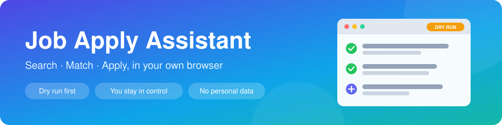
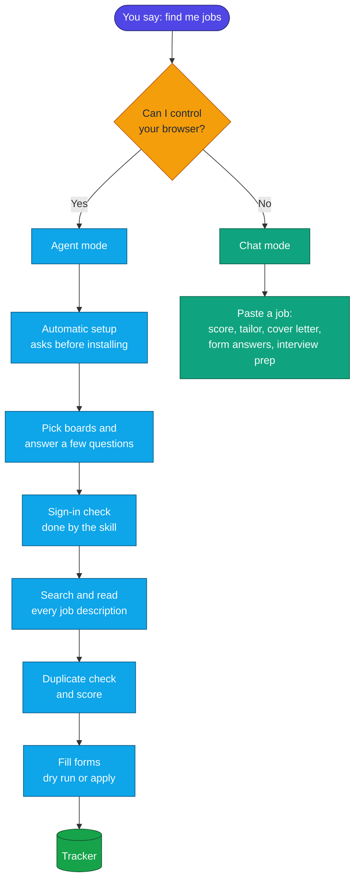
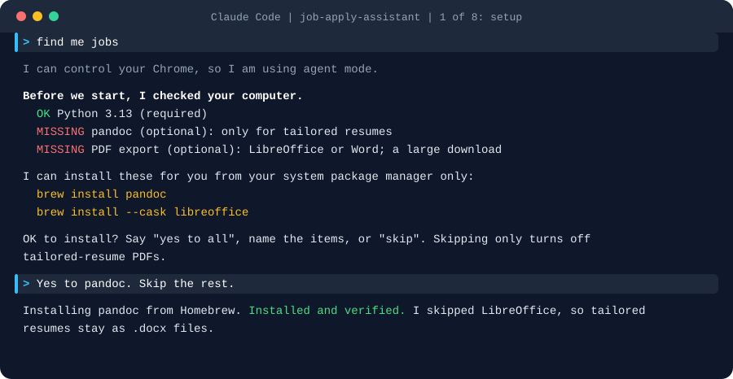
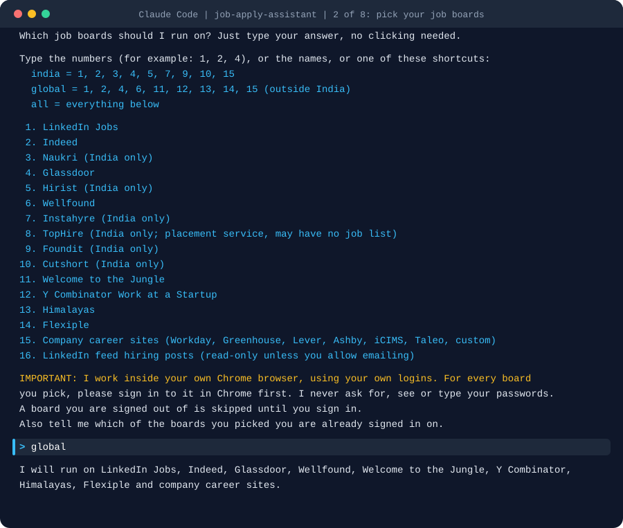
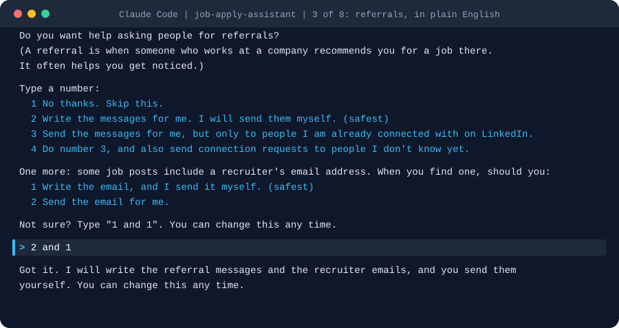
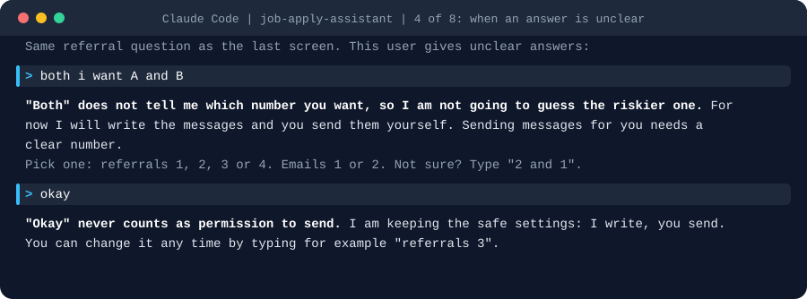
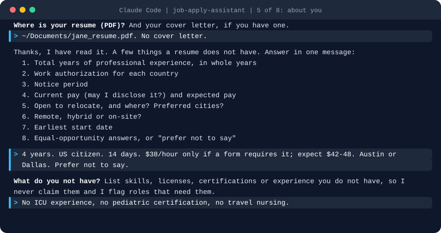
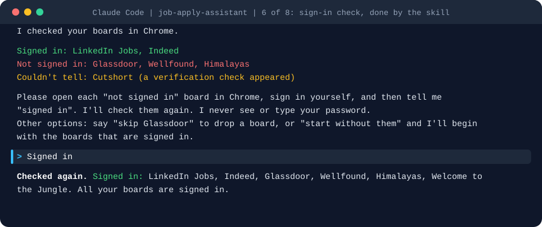
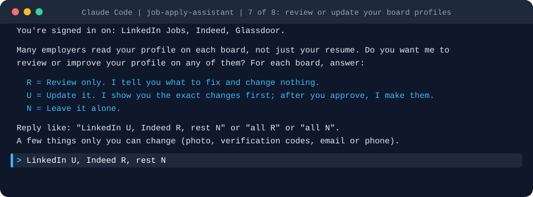
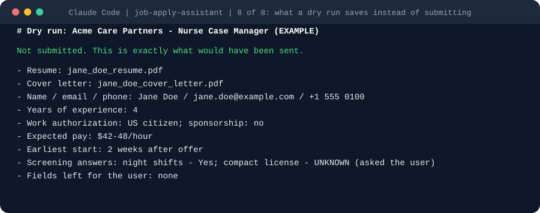

> [!WARNING]
> **Built on Claude.** This skill is made for Claude (Claude Code) and may not work the same in other AI agents like Cursor, Gemini or ChatGPT. You can still try it there: start with the chat-mode prompt in [`portable/`](portable/README.md).

<p align="center">
  
</p>

<p align="center">
  
  
  
  
  
  
</p>

<p align="center">
  <b>Finds jobs that fit your resume, fills the applications in your own logged-in browser, and keeps a tracker.</b><br>
  You stay in control: it shows you a summary before it submits anything.
</p>

<p align="center">
  <a href="#quick-start">Quick start</a> &nbsp;|&nbsp;
  <a href="#where-does-it-run">Where it runs</a> &nbsp;|&nbsp;
  <a href="#how-it-works">How it works</a> &nbsp;|&nbsp;
  <a href="#you-stay-in-control">Safety</a> &nbsp;|&nbsp;
  <a href="#commands">Commands</a> &nbsp;|&nbsp;
  <a href="#contributing">Contribute</a> &nbsp;|&nbsp;
  <a href="#troubleshooting">Troubleshooting</a>
</p>

---

## What you get

<table>
  <tr>
    <td width="25%" valign="top"><h4>Search</h4>16 job boards, every job description actually read, no judging by title</td>
    <td width="25%" valign="top"><h4>Match</h4>Scores each job 0 to 100 and tells you the best reason to apply and the biggest risk</td>
    <td width="25%" valign="top"><h4>Apply</h4>Fills forms from your profile in your own Chrome. Dry run first, then you approve</td>
    <td width="25%" valign="top"><h4>Track</h4>Every job logged, with a cross-board duplicate check so you never apply twice</td>
  </tr>
</table>

It ships with **no personal data**. Your profile, preferences, resume and tracker live in a workspace folder on your computer (default `~/job-hunt/`), created by a short onboarding chat the first time you use it.

## How it works



## What it looks like

This is the first run, screen by screen, with a made-up user (Jane, a nurse). The question screens (2, 3, 6, 7 and 8) are **generated from the skill's own files**, so their wording is exactly what you will see. The assistant words the other messages itself (screens 1, 4 and 5), so yours will differ a little.

<p align="center">
  <br>
  <sub><b>1. Setup.</b> It checks your computer and asks before installing anything.</sub>
</p>

<p align="center">
  <br>
  <sub><b>2. Pick your boards.</b> Type numbers, names or a shortcut. No clicking.</sub>
</p>

<p align="center">
  <br>
  <sub><b>3. Referrals, in plain English.</b> Simple numbers; the safest choices are listed first.</sub>
</p>

<details>
<summary><b>Screens 4 to 8</b>: unclear answers, about you, sign-in check, board profiles, dry-run record</summary>

<p align="center">
  <br>
  <sub><b>4. When an answer is unclear.</b> "Both" or "okay" never means "send". It keeps the safe choice and asks again.</sub>
</p>

<p align="center">
  <br>
  <sub><b>5. About you.</b> Your resume, then the few things a resume can't answer.</sub>
</p>

<p align="center">
  <br>
  <sub><b>6. Sign-in check.</b> The skill checks each board itself, then tells you which logins are missing.</sub>
</p>

<p align="center">
  <br>
  <sub><b>7. Board profiles.</b> Review only, update after you approve, or leave it alone.</sub>
</p>

<p align="center">
  <br>
  <sub><b>8. Dry-run record.</b> What would have been sent, saved instead of submitted.</sub>
</p>

</details>

These screens are drawn like a terminal because that is how Claude Code looks. The Claude desktop app and chat apps look different but ask the same questions. Maintainers can rebuild the images with `python3 docs/make_screens.py`.

## Where does it run?

| How you use it | Works with | Browser automation | Status |
|---|---|---|---|
| **Agent mode**: searches boards, fills forms, tracks, dry run | **Claude Code** and the Claude desktop app | Yes, through a Chrome automation extension |  scripts and conversations tested; live runs on real boards still being proven |
| **Agent mode on other tools** | Other coding agents with a browser tool (see `AGENTS.md`, `GEMINI.md`) | Only if the tool controls your own browser |  untested |
| **Chat mode**: profile, scoring, tailored resume text, cover letters, form answers, interview prep | **ChatGPT, Gemini, Claude chat**, any assistant with custom instructions | No. You do the clicking |  see [`portable/README.md`](portable/README.md) |

> [!NOTE]
> **Only use ChatGPT or Gemini?** Start with chat mode. You paste one prompt (`portable/ASSISTANT-PROMPT.md`) into a custom GPT, a Gem or a Claude project. It can't search boards or fill forms, because chat apps can't control your browser.

## Quick start

1. **Copy this folder** to `~/.claude/skills/job-apply-assistant/` (or to `<your project>/.claude/skills/job-apply-assistant/`).
2. **Start a new Claude Code session** and say **"find me jobs"**. The skill checks your computer, offers to install anything missing (after your yes), then asks a few questions.
3. **Sign in to your job boards in Chrome** before the search starts.

> [!IMPORTANT]
> The skill works inside **your own Chrome browser, using your own logins**. It never asks for, sees or types your passwords. A board you are signed out of is skipped until you sign in.

> [!TIP]
> Say **"dry run"** for your first run. It fills the forms but never presses Submit, so you see exactly what would be sent.

## What you need

| Required | Why |
|---|---|
| **Claude Code** (desktop app or CLI) | Runs the skill |
| **A browser-automation tool for your AI assistant** that drives your own Chrome, for example the **Claude in Chrome** extension (install it from Anthropic's current instructions) | Lets the assistant search boards and fill forms where you are already signed in |
| **Google Chrome**, signed in to the boards you want | The skill uses your existing logins |
| **Your resume as a PDF** | Uploaded to forms and read to build your profile |
| **Python 3.9 or newer** (`python3 --version`) | Runs the duplicate checker and resume helper |

<details>
<summary><b>Optional tools</b> (install only what you need)</summary>

| What | When you need it |
|---|---|
| **pandoc** (https://pandoc.org) + **LibreOffice** (https://www.libreoffice.org) or Microsoft Word | Only for tailored resumes (`tailor` mode): Markdown -> DOCX -> PDF |
| **Gmail and Google Calendar connectors** | Only for `inbox` mode (recruiter email -> draft replies and interview slots) |
| **An Apify account + `APIFY_TOKEN`** (https://apify.com) | Only if you want bulk search without the browser |
| **A LinkedIn account** | Only for the LinkedIn board and the referral/DM pass |

</details>

<details>
<summary><b>Files and information to have ready</b> (about five minutes)</summary>

1. **Resume (PDF)**, the version you want sent by default. Keep it under 2 MB (LinkedIn's limit). A `.md` or `.docx` copy is only needed for per-job tailoring.
2. **Cover letter (PDF)**, optional. Say whether to attach it everywhere there is an upload slot.
3. **Certificates or transcripts**, optional. Some company forms ask for them.
4. **Links**: LinkedIn, GitHub, portfolio (or "none").
5. **Answers a resume does not contain:** work authorization for each country, notice period, current and expected pay (and whether to disclose current pay), relocation, preferred cities, remote or on-site, earliest start date.
6. **A list of skills you do NOT have.** This keeps the skill from putting you in roles you cannot do and from claiming a skill on a form.
7. **Which boards you use and are signed in on** (the skill asks).

</details>

### Automatic setup

You don't need to install the helper tools yourself. On the first run the skill shows what is missing, for example:

> Missing: pandoc (only for tailored resumes). It would run `brew install pandoc`.
> OK to install? Say "yes to all" or name the items.

It installs only after your yes, and only from your system's package manager (Homebrew on macOS, apt or dnf on Linux). It never runs scripts from the internet, never installs Homebrew for you, and never types your password: if a command needs `sudo` it prints it for you to run.

It **cannot** install the Chrome automation extension for you, because Chrome needs your click to add any extension. The skill checks whether it is connected, tells you the exact steps if not, and checks again when you say "done". Gmail and Calendar connectors are only for `inbox` and you grant them yourself.

By hand: `scripts/install_missing.sh plan` shows what is missing, and `scripts/install_missing.sh install pandoc --dry-run` shows a command without running it. `scripts/doctor.sh` checks Python, pandoc, your resume path and the optional tools.

## First run: what it asks

Say **"find me jobs"** or **"run the job-apply-assistant skill"**. It asks, in order:

| # | Question | In short |
|---|---|---|
| 1 | **Which job boards?** | One message, 16 numbered boards. You **type** numbers (`1, 2, 4`), names, `all`, or a shortcut (`india`, `global`). It repeats your choice once. |
| 2 | **Referrals (optional)** | "Do you want help asking people at companies to refer you?" Type 1 (no thanks), 2 (write the messages, you send them), 3 (send to people you're already connected with), or 4 (also send connection requests). A second question covers recruiter emails: 1 (write it, you send) or 2 (send it for you). Not sure? Type "1 and 1". |
| 3 | **Your resume** | And your cover letter. It builds `profile.md`. |
| 4 | **What a resume lacks** | Years of experience, work authorization, notice period, pay, relocation, cities. |
| 5 | **Skills you do not have** | So it never claims them. |
| 6 | **Run rules** | Experience range, ask before applying, search depth, abroad and remote, optional consent boxes. |
| 7 | **Dry run first?** | Recommended. |
| 8 | **Keyword check** | The job titles and gaps it found. You edit them. |
| 9 | **Confirm the profile** | Nothing runs until you approve. |
| 10 | **Sign-in check, done by the skill** | It opens each board in your Chrome and tells you which are signed in, signed out, or unclear. You sign in, say "signed in", and it re-checks only those. |
| 11 | **Board profiles** | For each signed-in board: **R** review only, **U** update after you approve the exact changes, or **N** leave it alone. Facts from your resume only. |

Everything is saved in the workspace, so the next run skips onboarding.

## Every run

| Step | What happens |
|---|---|
| **1. Search** | Search bar, several keyword combinations, last 24 hours then 7 days, home city plus remote (abroad if you allowed it). It **opens and reads every job description**. |
| **2. Duplicate check** | The same job on LinkedIn, Indeed and Naukri is applied to once (`scripts/dedupe_check.py`): job ids, URLs, company + title + city. |
| **3. Score** | 0 to 100 with the main reason to apply and the main risk. You can drop rows. |
| **4. Tailor** | Only when a job needs a skill you really have that your resume buries. True bullets reframed, nothing invented. |
| **5. Apply** | Fills the form, checks every autofilled field, answers screening questions (asks once for unknowns, then remembers), shows a summary, submits after your OK. |
| **6. Log** | `applications.csv`: applied, skipped (with the reason), failed, queued, or unverified. |
| **7. Report** | Counts, what is waiting on you, searches that stopped early and why. |

## You stay in control

> [!WARNING]
> **What it will never do:** invent facts, type government IDs, passwords or bank details, solve CAPTCHAs, create accounts, accept background or credit-check consents, or send messages without your go-ahead.

**What you will have to do yourself** (each item goes into `queue.md`):

- government IDs, tax numbers, bank details, passwords and one-time codes
- CAPTCHAs, human-verification checks, logins and timed assessments
- legal declarations and consents (background, credit, criminal checks)
- anything it cannot do in a custom form widget (for example some date pickers or upload buttons). It tells you exactly which field is left.

> [!CAUTION]
> Some job sites forbid automation in their terms of use. You use this on your own accounts at your own risk, and a site may limit or suspend an account for automated use. Your resume and answers go to the employers and boards you apply to; the skill sends nothing anywhere else.

## Commands

| Say | What happens |
|---|---|
| "find me jobs" / "apply to jobs" | Full run (search, shortlist, apply) |
| `dry-run` | Full flow, never presses Submit, saves what it would send. Recommended first |
| `doctor` | Checks your setup and tells you what is missing |
| `profile-update <board>` | Review or update your profile on one signed-in board (never applies to jobs) |
| `search <role> in <city>` | Search and score only, no applying |
| `status` | Funnel summary from your tracker, flags stale applications |
| `tailor <job url>` | Build a tailored resume for one posting |
| `inbox` | Recruiter email -> draft replies and calendar proposals (drafts only) |
| `prep <company>` / `mock <company>` / `debrief <company>` | Interview brief, mock interview, post-call notes |
| `followup` | Draft follow-up notes for applications older than 7 days |
| `review` | Weekly analysis and three changes for next week |

## More

<details>
<summary><b>Files it creates in your workspace</b></summary>

```
~/job-hunt/
  profile.md          who you are (facts only, never guessed)
  preferences.md      the run rules you chose
  applications.csv    one row per job: date, company, title, location, source, URL, resume used,
                      status, score, notes, job_key
  queue.md            things waiting on you (logins, codes, unknown answers)
  referral-queue.csv  only if you enabled the referral/DM pass
  postings/  tailored/  dry-runs/  interviews/  followups/  reviews/  pipeline.csv
```
These hold personal data. Keep them out of public repos and never paste them into other tools.

</details>

<details>
<summary><b>Examples and scheduling</b></summary>

- `examples/` has made-up sample files (a profile, preferences, a tracker with a duplicate and an unverified row, a shortlist, a waiting-on-you queue, and a dry-run record) so you can see what you will get before you start.
- `references/scheduling.md` explains how to run a daily 24-hour search (search or dry-run only) and what cannot run unattended.

</details>

<details id="troubleshooting">
<summary><b>Troubleshooting</b></summary>

| Symptom | What to do |
|---|---|
| "Board is signed out" | Sign in in Chrome, say "signed in", it continues |
| Cloudflare or "verify you are human" page | Complete it yourself; the skill never bypasses it |
| LinkedIn stops loading jobs | It throttles after about 15 rapid loads; wait and let the skill pace itself |
| Status says `unverified` | The page showed no confirmation after Submit; check the board's "Applied" list and tell the skill the result |
| A form field would not take typed text | Custom widget; the skill tells you which field to fill by hand |
| Resume upload not possible on a board | Some boards (Naukri, LinkedIn Easy Apply) only use the resume saved to your account; update it there once |
| `doctor` reports MISSING | Fix the listed item, run it again |
| Tailored PDF will not build | Install `pandoc` and LibreOffice (or Word), or open the generated `.docx` and export a PDF |

</details>

<details>
<summary><b>Repository layout</b></summary>

```
SKILL.md                         entry point: rules, onboarding, phases, modes
references/boards-catalog        the 16 boards, asked in one plain message
references/job-boards            search method, per-board notes, ATS quirks, speed tricks
references/preferences-template  run rules the user chooses at onboarding
references/profile-template      candidate profile shape (includes "skills I do NOT have")
references/apply-playbook        per-application loop, human-only fields, stop conditions
references/match-rubric          scoring and dealbreakers
references/tailoring             reframe-never-invent resume tailoring
references/referrals-and-dms     optional referral / DM pass, off by default
references/board-profile-update  optional review/update of your profile on each signed-in board
references/signin-check          the skill checks each board's login itself and reports what's missing
references/{follow-ups,inbox-to-calendar,interview-prep,weekly-review,apify,scheduling}
scripts/install_missing.sh       installs missing tools from your package manager, only after your yes
scripts/doctor.sh                setup check (Python, pandoc, resume path, optional tools)
scripts/dedupe_check.py          cross-board duplicate check
scripts/build_resume.sh          markdown -> docx -> pdf (pandoc; Word or LibreOffice)
scripts/tailor.py                reorder/reword a base resume, then build
portable/                        chat mode: one prompt for ChatGPT, Gemini or Claude chat, plus setup steps
AGENTS.md, GEMINI.md             pointers for other coding agents (experimental)
docs/banner.svg                  the banner image at the top of this README
docs/screens/                    the screen images in "What it looks like" (built by docs/make_screens.py)
docs/make_screens.py             builds those images from the skill's own text, so they never drift
examples/                        made-up sample files
```

</details>

<details>
<summary><b>Publishing checklist</b> (maintainers)</summary>

Before publishing, confirm nothing personal is in the folder:
```bash
grep -rniE '@(gmail|outlook|yahoo)\.|[0-9]{10}|/Users/|Desktop|Downloads' .
```
Expected: only the example paths in this README. Never add `profile.md`, `preferences.md`, `applications.csv`, `queue.md`, resumes or cover letters (see `.gitignore`).

Ways to publish:
- **GitHub repo:** put this folder at the repo root (or under `skills/job-apply-assistant/`). The `LICENSE` file (MIT) is already included. Users copy the folder into `~/.claude/skills/`.
- **Claude Code plugin:** wrap it with a `.claude-plugin/plugin.json` and a `skills/job-apply-assistant/` directory, then list it in a plugin marketplace repo.
- **Zip:** `zip -r job-apply-assistant.zip job-apply-assistant -x '*.DS_Store'`.

If this will be shared outside your company or organization, check whether your employer needs to sign off on it first.

</details>

## Contributing

**Ideas, fixes and upgrades are welcome.** Anyone with a GitHub account can suggest an edit. You don't need to ask first.

1. **Fork** this repo (the Fork button, top right). That makes your own copy.
2. **Make a branch** in your copy, change what you want, and push it there.
3. **Open a pull request** to this repo. Say what you changed and what you tested.
4. **I review it.** Nothing goes into `main` without my approval, and I'm the only person who can merge. I may ask you to change something first.

> [!NOTE]
> Nobody else has write access to this repo, and `main` is protected, so a pull request from your fork is the way in. That keeps every change reviewed before it reaches the people who use the skill.

**Built something on top of this?** A new job board, a better prompt, a version for another assistant: open a pull request and I'll look at it. You can also message me on LinkedIn to talk it through first: [linkedin.com/in/ojas-chopade](https://www.linkedin.com/in/ojas-chopade). Please don't send code in messages. Open a pull request so it can be reviewed in the open. Messaging me doesn't skip the review.

**Want your own version?** The MIT license lets you modify it freely. If your version is better, send the changes back.

**Not a coder?** Open an [issue](https://github.com/ojas8050/job-apply-assistant/issues) with your idea or the problem you hit.

Please read [`CONTRIBUTING.md`](CONTRIBUTING.md) first. It lists what is welcome, what will be rejected (personal data, or anything that weakens the safety rules), and the checks to run before you open a pull request.

## License

MIT. See [`LICENSE`](LICENSE). The skill is provided as is, without warranty: you are responsible for what is submitted in your name on job boards. Please review each application, and use the dry-run mode first.
